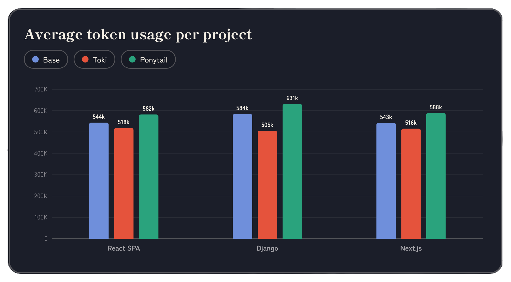
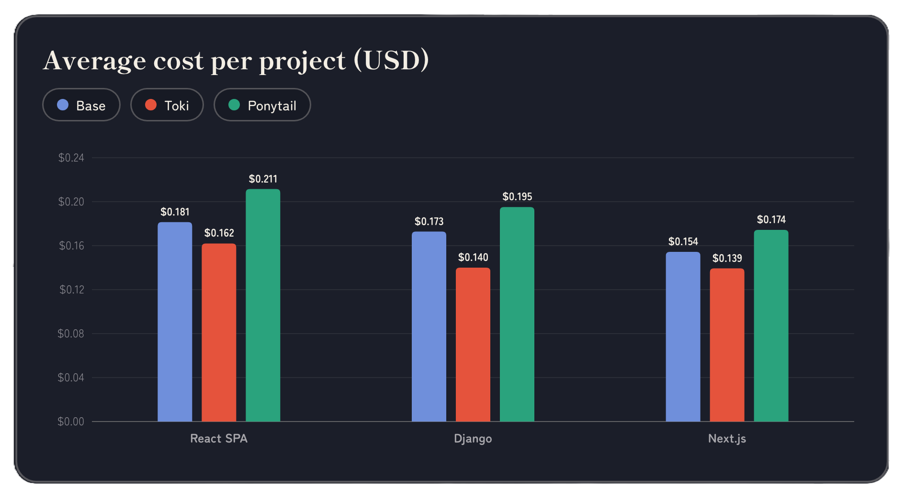
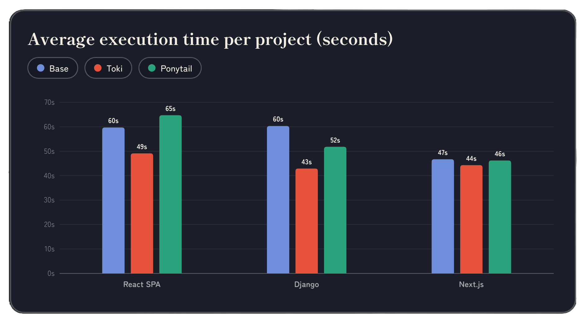

<p align="center">
  <picture>
    <source media="(prefers-color-scheme: dark)" srcset="assets/logo-dark.png">
    
  </picture>
</p>

<h1 align="center">Toki</h1>

<p align="center">
  <em>Claude Code plugin for token-efficient coding and clean project structure.</em>
</p>

<p align="center">
  
  
  
</p>

Meet Toki - compact, precise and leaves no waste.

Built entirely from scratch, Toki is a Claude Code plugin designed with a singular focus: **maximizing token efficiency while maintaining a clean project structure.** It outperforms previous token-saving plugins by ensuring your AI agent writes exactly what is needed — nothing more, nothing less.

## Install

Install Toki for **Claude Code** via the terminal:

1. Add the Toki marketplace:

```bash
claude plugin marketplace add BuildBias/toki
```

2. Install the plugin:

```bash
claude plugin install toki@toki
```

## Benchmark





Plain Claude Code (Base), Claude with Toki, and Claude with the
Ponytail plugin each got the same 5 everyday coding prompts in three different projects: React, Django and Next.js project with Claude Sonnet

See [benchmarks/METHODOLOGY.md](benchmarks/METHODOLOGY.md) for how the runs were set up and measured.

## How it works

No cluttered menus. No endless lists of slash commands. Toki operates as a single, highly optimized skill ([`skills/toki/SKILL.md`](skills/toki/SKILL.md)) that acts as a **mandatory file-placement guardrail**.

Before creating a file, Toki has the agent look at your project once, decide where the file belongs, and write it in as few turns as possible. It is extremely lazy about generating bloat, but strict about project structure.

Whenever Claude needs to create, add, move, or rename a file, Toki intercepts the action to enforce four strict rules:

1. **Aggressive Batching (Zero Wasted Turns):** Instead of wasting tokens on sequential `ls`, `cat`, and `mkdir` commands, Toki forces the agent to bundle its file discovery into a single, highly targeted shell command. It writes new files and their wiring edits together, and strictly limits the agent's reply to two plain sentences. No yapping.
2. **Strict Routing:** Toki stops the agent from dumping new files in your project root. It enforces one file per unit (component, handler, model, etc.) and routes them to their standard framework directories or your existing folder structure. 
3. **Preservation:** AI agents have a bad habit of accidentally deleting or shortening existing files when refactoring. Toki strictly prohibits rewriting or emptying existing files. If a file must be moved, Toki ensures it is transferred byte-for-byte intact.
4. **Lean Execution:** Toki prevents the agent from running unauthorized builds, retrying blocked commands, or generating unasked-for boilerplate like READMEs or configs.

## License

[MIT](LICENSE)